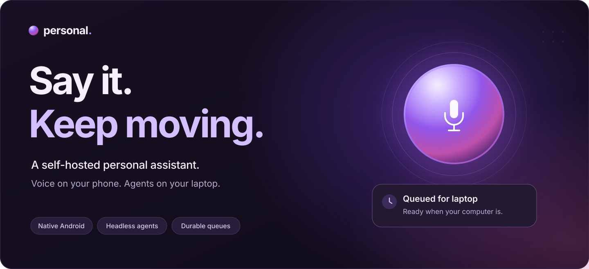
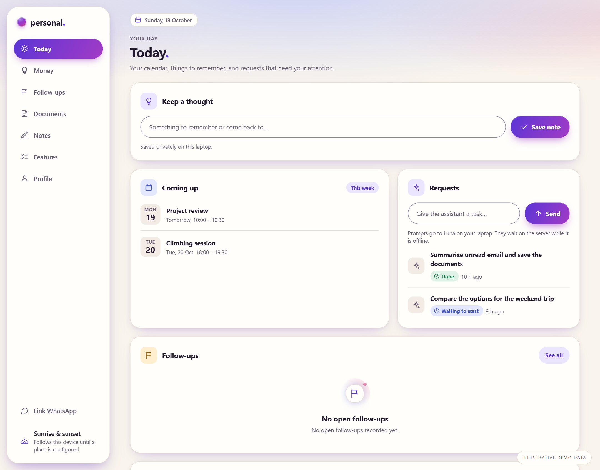
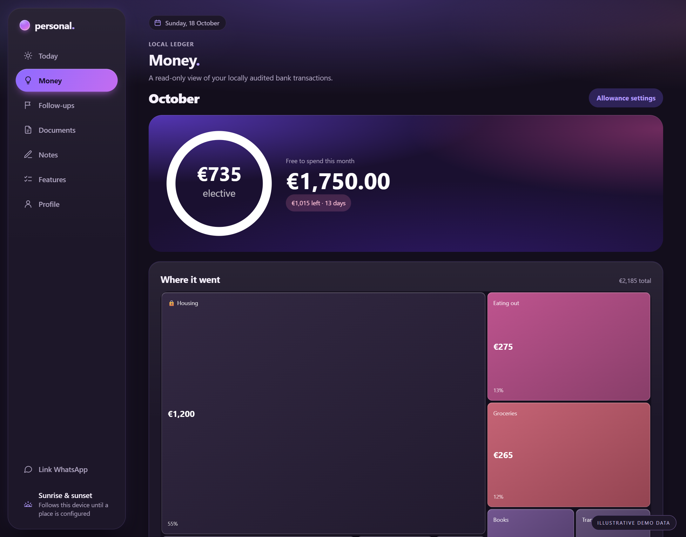
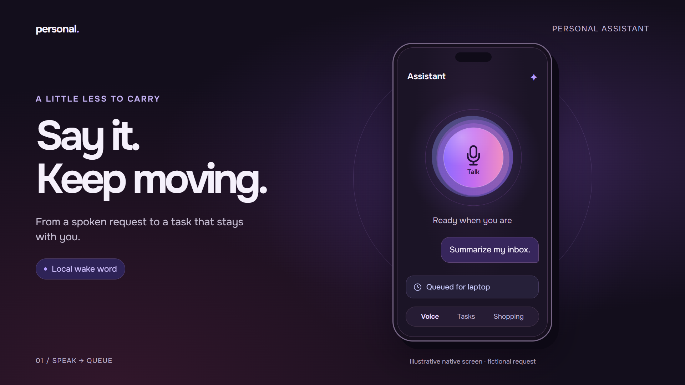
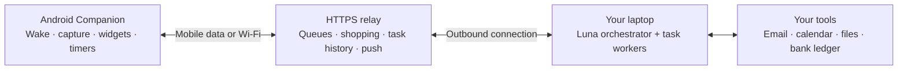

<div align="center">



**A phone-first assistant with real tools, persistent agents, and a life outside the chat window.**

[Explore the app](#the-app-in-use) · [How it works](#the-system) · [Run your own](#run-your-own) · [Roadmap](docs/roadmap.md)

[](https://github.com/Ayoub-Mabkhout/personal-ai-assistant/actions/workflows/ci.yml)
[](https://github.com/Ayoub-Mabkhout/personal-ai-assistant/releases/latest)


</div>

## A thought should become a task. Not another thing to remember.

Say **“Hey Chat”**, give the assistant a job, and get on with your day.
The native Android app captures the request, the cloud relay stores it in
its queue, and a persistent orchestrator picks the right laptop agent to do it.
You get status updates, a result, and a conversation you can return to.

The laptop can sleep. The queue remembers. Your shopping list still works.

```text
“Summarize my unread email and save the attachments.”
“Add eggs, coffee, and sparkling water to my shopping list.”
“Set a timer for 12 minutes.”
```

These are examples of supported workflows. Connected accounts and model access
are configured by each deployment.

## The app, in use

<table>
  <tr>
    <td width="50%"><a href="docs/media/today-light.png"></a></td>
    <td width="50%"><a href="docs/media/money-dark.png"></a></td>
  </tr>
  <tr>
    <td><strong>Your day, with the details in reach.</strong><br/>Calendar, requests, follow-ups, and a place to save a thought.</td>
    <td><strong>A ledger you can have a conversation with.</strong><br/>Spending, recurring costs, and a financial auditor that retains your corrections.</td>
  </tr>
</table>

<sub>Real dashboard screens, rendered with fictional demo data. Click a screen to inspect it. Dusk Aurora spans warm light mode, ink-and-plum dark mode, and the native Companion.</sub>

<details>
<summary><strong>See the voice-to-task flow</strong></summary>



<sub>A source-inspired illustration of the native flow, using a fictional request. The actual Companion also includes Money, widgets, notifications, and settings.</sub>

</details>

## Small everyday jobs. Proper agent work. One assistant.

| | What you can do |
| :--- | :--- |
| **Voice & phone** | Local **Hey Chat** detection, buffered capture, single-command acknowledgements, optional conversation mode, timers, alarm handoff, and home-screen widgets. |
| **Tasks & agents** | Submit by voice, text, or dashboard. Follow queued → working → completed states. Open a result, add an instruction, and resume the **same worker session**. |
| **Shopping & recipes** | Keep a cloud list that works while the laptop is off. Make multi-item edits, import recipes, select ingredients, and replay offline changes without duplicate mutations. |
| **Money** | Import read-only bank transactions. Explore categories and recurring costs, track income and allowance, inspect explanations, and teach a persistent specialist with your corrections. |
| **Life admin** | Use an assistant-owned calendar, reminders and snooze, live email tools, attachment filing with provenance, follow-up tracking, notes, documents, and an editable personal profile. |

### The agent keeps the thread

A persistent Luna orchestrator chooses the worker, model, effort, and relevant
skills. Coding, email, and other tool-driven jobs run headlessly on the laptop.
Tasks retain their execution history and follow-ups resume the recorded worker
session. A long agent job does not block the separate programmatic queue.

[Task dispatch](docs/task-dispatch.md) · [Task history & updates](docs/phone-task-status.md) · [Notification replies](docs/notification-replies.md)

### Your money gets more than a category label

The dedicated financial auditor keeps an ordered job queue, a persistent session,
and a dated spending narrative. It interprets transactions; code calculates the
totals. Your explicit corrections take precedence over model decisions.

The interface puts the spending map at the center, separates fixed costs from
free spending, and lets you inspect the payments and reasoning behind a category.
Bank connections are **read-only**: this integration cannot move money.

[Money architecture & behavior](docs/money.md)

### The useful parts stay useful offline

The phone stores captured commands and shopping edits for retry. The relay
holds laptop tasks until the worker reconnects. Shopping talks directly to the
cloud; timers run on the phone. Projected calendar reminders can be delivered
without the laptop being awake.

Offline means **saved and waiting**, not a fabricated success message.

[Connectivity](docs/connectivity-and-integrations.md) · [Shopping & recipes](docs/groceries.md) · [Calendar reminders](docs/calendar-reminders.md)

## The system



| Layer | Responsibility |
| :--- | :--- |
| **Phone** | Wake detection and audio buffering, interface, local capture queue, timers, notification actions, and widgets. |
| **Cloud** | Always-on HTTPS access, durable queues, shopping and recipes, task history, reminder projection, and native push events. |
| **Laptop** | Headless agents, connected tools, the primary calendar, document vault, financial ledger, and local dashboard. |

Wake detection runs locally. Transcription and optional Realtime conversation use
configured cloud providers; model requests may include task context. This is
self-hosted orchestration, not a claim that every model runs on-device.

[Architecture](docs/architecture.md) · [Native Companion](docs/companion-app.md) · [Design system](docs/design-system.md)

## Run your own

This is a configurable system, not a hosted account you sign into. A clone starts
with reusable code and empty configuration: it does not inherit anyone's inbox,
phone pairing, profile, bank connections, or deployment.

**Start with the local Python workspace:**

```powershell
git clone https://github.com/Ayoub-Mabkhout/personal-ai-assistant.git
cd personal-ai-assistant
python -m venv .venv
.venv/Scripts/python.exe -m pip install -e '.[server,test]'
.venv/Scripts/python.exe scripts/bootstrap_workspace.py
./scripts/verify.ps1
```

Then connect the pieces:

1. **Deploy the relay:** follow [server deployment](docs/server-deployment.md) to configure HTTPS and owner authentication.
2. **Start the laptop services:** configure the worker and dashboard using [laptop services](docs/laptop-services.md). Agent backends need their own authenticated access.
3. **Pair the phone:** install [Assistant Companion](https://github.com/Ayoub-Mabkhout/personal-ai-assistant/releases/latest), then follow [native setup](docs/native-companion.md).
4. **Connect the tools you want:** [email](docs/mail-ingestion.md), [calendar](docs/calendar.md), [Money](docs/money.md), or [Termux phone scripting](docs/termux-bridge.md).

The Android app supports Android 8 and later. Speech APIs, model access,
Firebase push configuration, and hosting have separate setup and possible costs.
A self-built APK needs your own signing identity and Firebase client configuration.
The code has no assistant-hosting subscription; provider plans determine your bill.

[Release and signing setup](docs/releases.md) · [Hosting notes](docs/costs.md) · [Environment layout](docs/repository-layout.md)

## Built to be extended, not filled with somebody else's data

```text
apps/android/             Native Companion
apps/dashboard/           Local dashboard
src/personal_assistant/   Relay, workers, calendar, mail, banking, and domain logic
skills/                   Reusable agent skills
scripts/                  Setup, automation, validation, and release routines
infra/server/             Server deployment
```

Personal profiles, documents, databases, and traces live in ignored runtime
storage. Credentials belong in a protected store outside the repository;
`private/auth/` holds references and metadata. A publication guard runs before
commits and in CI. Git ignore is a source-control boundary, not encryption.

For a new capability, add the domain behavior, expose it through the appropriate
worker or relay path, and give task agents a focused skill. Keep personal facts
as runtime inputs. Tests use temporary stores and fake providers.

[Storage boundaries](docs/repository-layout.md) · [Coding workbench](docs/coding-workbench.md) · [Personal context](docs/personal-profile.md)

## What's next

The system is under active development. Semantic file search, richer attachment
handling, bank-consent renewal reminders, and more phone controls remain on the
[roadmap](docs/roadmap.md). Provider support, phone battery behavior, and physical
handset verification are separate from passing local tests.

The full checklist lives in [docs/roadmap.md](docs/roadmap.md). The Companion and
dashboard also share an editable [Features list](docs/features-checklist.md).

<details>
<summary><strong>Documentation map</strong></summary>

| Area | Guides |
| :--- | :--- |
| **Start & operate** | [Deployment](docs/server-deployment.md) · [Laptop services](docs/laptop-services.md) · [Releases](docs/releases.md) · [Costs](docs/costs.md) |
| **Voice & phone** | [Voice](docs/phone-voice.md) · [Wake detection & buffering](docs/custom-phone-voice.md) · [Native notifications](docs/native-companion.md) · [Widgets & alarms](docs/phone-companion.md) · [Termux](docs/termux-bridge.md) |
| **Agents & context** | [Dispatch](docs/task-dispatch.md) · [Task updates](docs/phone-task-status.md) · [Coding workbench](docs/coding-workbench.md) · [Profile](docs/personal-profile.md) |
| **Everyday tools** | [Calendar](docs/calendar.md) · [Reminders](docs/calendar-reminders.md) · [Groceries](docs/groceries.md) · [AnyList migration](docs/anylist-migration.md) · [Money](docs/money.md) |
| **Mail & documents** | [Ingestion](docs/mail-ingestion.md) · [Background collection](docs/mail-automation.md) · [WhatsApp](docs/whatsapp.md) · [Repository layout](docs/repository-layout.md) |

</details>
